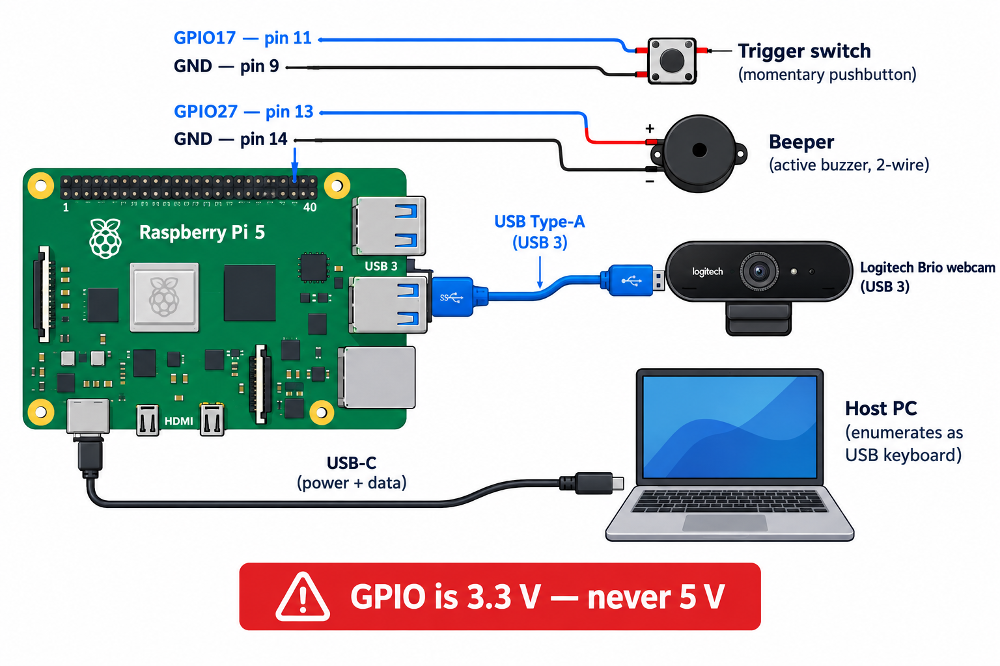

# piscan

`piscan` is a low-latency Raspberry Pi 5 barcode scanner for a generic UVC USB webcam and an external GPIO trigger. Results are sent to a CLI sink today; the sink interface leaves room for a display later.

Target OS: **Raspberry Pi OS Lite (Debian 13 Trixie, 64-bit)** on a Pi 5.

## Hardware

- Raspberry Pi 5 and a UVC-compatible USB webcam (tested target: Logitech Brio, USB 3).
- For the default trigger, connect a momentary switch between BCM GPIO17 (header pin 11) and GND (pin 9). The internal pull-up is enabled by default.
- For the beeper, connect a 2-wire active buzzer between GPIO27 (pin 13, `+`) and GND (pin 14, `-`). Enable it with `--beeper-line 27` (set `--beeper-ms` for tone length).
- GPIO is **3.3 V only**. Never connect a 5 V signal. Use an optocoupler for 12/24 V industrial triggers.
- Add the user to the `video` and `gpio` groups for device access.



## Quick start

Build and test with:

```sh
./scripts/build.sh
```

Install and enable the systemd service:

```sh
sudo ./scripts/install-service.sh
```

Edit `/etc/default/piscan` to change the service arguments, then restart it with `sudo systemctl restart piscan`. Follow scan output with `journalctl -u piscan -f`; add `-o cat` to view raw JSON lines. To remove the service and installed binary, run `sudo ./scripts/install-service.sh --uninstall`.

## First boot

1. Flash the SD card with Raspberry Pi Imager; set the user, Wi-Fi and enable SSH in the Imager customization.
2. `sudo apt update && sudo apt install -y git`
3. Clone the repo (it's private — authenticate with `gh auth login` or an HTTPS personal access token):
   `git clone https://github.com/jeb886/pi-project.git && cd pi-project`
4. `./scripts/build.sh` then `sudo ./scripts/install-service.sh`

## Build

Manual equivalent of `scripts/build.sh`:

```sh
sudo apt install build-essential cmake git pkg-config libturbojpeg0-dev v4l-utils
cmake -B build -DCMAKE_BUILD_TYPE=Release -DPISCAN_NATIVE=ON
cmake --build build -j4
```

`PISCAN_NATIVE=ON` optimizes for the Pi's CPU and is recommended when building on the target device. Cross-builds should leave it off.

## Usage

```sh
piscan devices
piscan scan --device /dev/video0
piscan scan --width 640 --height 480 --pixfmt yuyv --formats QRCode,Code128 --stats
piscan trigger --gpio-line 17
piscan trigger --trigger stdin --output json
piscan decode tests/data/qr --expect
piscan bench sample.pgm --iterations 100
```

`scan` runs continuously. `trigger` starts one scan session per press by default; use `--trigger-mode level` to scan while held. Press Enter to trigger with `--trigger stdin`. Output is plain decoded text by default, one JSON object per line with `--output json`, or keystrokes into the host PC with `--output hid`. With `--beeper-line N` a short beep follows every decoded result (the service default is GPIO27, 80 ms). Diagnostics and optional statistics go to stderr.

`decode` prints each file's result; with `--expect` it compares against `<name>.txt` sidecars (`NONE` = no barcode expected) and exits non-zero on any mismatch. `scan`/`trigger` accept `--source IMG_OR_DIR` (repeatable) instead of `--device` to replay image files through the full pipeline at `--fps`, looping `--repeat N` times (0 = forever) — a mock camera for test automation.

## USB keyboard-wedge mode

`install-service.sh` also configures the Pi's USB-C port as a USB gadget, so the Pi enumerates as a standard USB keyboard on whatever PC it is plugged into (no drivers needed on Windows, macOS, or Linux). Pressing the GPIO trigger scans a barcode and piscan types the decoded text plus Enter, like a commercial scanner wedge. The install:

- adds `dtoverlay=dwc3,dr_mode=peripheral` to `config.txt` (one reboot needed on first install),
- loads `libcomposite` and runs `piscan-gadget.service` at boot, which creates a keyboard gadget on `/dev/hidg0` via configfs,
- installs a udev rule so the unprivileged `piscan` service user can write it,
- defaults the service to `trigger --trigger gpio --output hid`.

Point the Brio at a barcode, press the trigger, and the text appears wherever the cursor is (open Notepad to verify). Non-US-ASCII characters that have no single-key mapping are skipped; the layout is US-QWERTY. Use `--output json` in `/etc/default/piscan` if you'd rather have journal output, and run `piscan --output text` manually for interactive use.

Note: the PC will also supply power over that cable; a Brio plus a running Pi 5 can exceed a port's budget, so powering the Pi through a separate 5 V supply is recommended.

## Performance

- Restrict `--formats` to the symbologies actually used; leave `--try-harder` off for speed.
- Try 640x480 or 1280x720 and measure with `--stats`.
- `--pixfmt auto` prefers uncompressed formats but picks MJPEG when raw formats cannot deliver the requested `--fps` at the requested size. On a Brio, 1080p and high frame rates (e.g. `--size 1920x1080 --fps 90`) are MJPEG-only — the Brio doesn't offer fast raw modes there. Raw 1080p YUYV is ~4 MB/frame, too much for high fps even on USB 3.
- YUYV decoding uses the camera's luma bytes without copying. MJPEG frames are decompressed gray-only with libturbojpeg; measure both paths with `--stats`.
- Perf regression numbers: `ctest -R piscan_perf_tests --output-on-failure` reports mean/p50/p99 decode time at 640x480/720p/1080p, the MJPEG decompress path, the real-photo sample set, and end-to-end trigger-to-result latency.
- Use a fixed, short exposure to reduce motion blur, crop with `--roi x,y,w,h`, and set the CPU governor to `performance` for sustained scanning.

## Architecture

One capture thread keeps the camera streaming and hands buffers to independent decoder workers. The pipeline is latest-frame-wins: stale pending frames are returned to the camera rather than building latency. Each worker owns its decoder. `ResultSink` separates scanning from text/JSON output and is the seam for a future display.