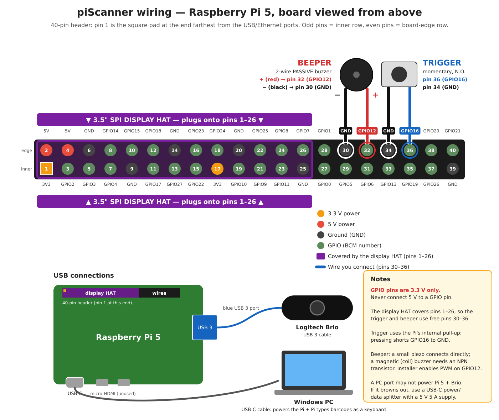

# piScanner

`piScanner` is a low-latency Raspberry Pi 5 barcode scanner for a generic UVC USB webcam and an external GPIO trigger. Results are sent to a CLI sink today; the sink interface leaves room for a display later.

Target OS: **Raspberry Pi OS Lite (Debian 13 Trixie, 64-bit)** on a Pi 5.

## Hardware

- Raspberry Pi 5 and a UVC-compatible USB webcam (tested target: Logitech Brio, USB 3).
- For the default trigger, connect a momentary switch between BCM GPIO16 (header pin 36) and GND (pin 34). The internal pull-up is enabled by default.
- For the beeper, connect a **passive** buzzer with `+` on BCM GPIO12 (header pin 32) and `-` on GND (pin 30). A small piezo can connect directly; drive a magnetic/coil buzzer through an NPN transistor.
- GPIO is **3.3 V only**. Never connect a 5 V signal. Use an optocoupler for 12/24 V industrial triggers.
- Add the user to the `video` and `gpio` groups for device access.



| Connect | Pi header pin | Signal |
|---|---|---|
| Trigger switch, leg 1 | pin 36 | GPIO16 |
| Trigger switch, leg 2 | pin 34 | GND |
| Beeper `+` (red) | pin 32 | GPIO12 |
| Beeper `-` (black) | pin 30 | GND |
| Logitech Brio | blue USB 3 port | — |
| Host PC | USB-C port | power + keyboard data |

Pin 1 is the square pad at the end of the header farthest from the USB/Ethernet ports; odd pins are on the inner row and even pins on the board-edge row. Pins 30 and 32 are adjacent on the board-edge row, so a 2-pin Dupont connector fits the beeper. Use a small piezo directly; a magnetic/coil passive buzzer needs an NPN transistor.

The passive beeper plays a startup chirp at 2471 Hz (low), 2752 Hz (medium), and 3056 Hz (high), each for `--beeper-ms` milliseconds. Each successful decode plays one medium beep; another decode while it is sounding extends that beep. The installer enables the PWM overlay for GPIO12 and prints a reboot-required notice.

With a 3.5" SPI TFT (ILI9486, e.g. the LCDWiki/MHS35-style HAT on header pins 1–26), `--display auto` (or `--display /dev/fbN`) draws the last scan plus a short history on the panel — no X needed, it renders straight into the DRM fbdev framebuffer. `sudo scripts/install-service.sh --with-display` adds the `mipi-dbi-spi` + `ads7846` (touch) overlays to `/boot/firmware/config.txt` and installs the `ili9486.bin` init blob; a reboot is required. The display HAT covers pins 1–26, which is why the trigger and beeper moved to pins 36/32.

## Quick start

Build and test with:

```sh
./scripts/build.sh
```

Install and enable the systemd service:

```sh
sudo ./scripts/install-service.sh
```

Re-running the installer migrates an existing `piscan` install to the new `piscanner` names.

Edit `/etc/default/piscanner` to change the service arguments, then restart it with `sudo systemctl restart piscanner`. Follow scan output with `journalctl -u piscanner -f`; add `-o cat` to view raw JSON lines. To remove the service and installed binary, run `sudo ./scripts/install-service.sh --uninstall`.

## First boot

1. Flash the SD card with Raspberry Pi Imager; set the user, Wi-Fi and enable SSH in the Imager customization.
2. `sudo apt update && sudo apt install -y git`
3. Clone the repo (it's private — authenticate with `gh auth login` or an HTTPS personal access token):
   `git clone https://github.com/jeb886/piScanner.git && cd piScanner`
4. `./scripts/build.sh` then `sudo ./scripts/install-service.sh`

## Build

Manual equivalent of `scripts/build.sh`:

```sh
sudo apt install build-essential cmake git pkg-config libturbojpeg0-dev v4l-utils
cmake -B build -DCMAKE_BUILD_TYPE=Release -DPISCANNER_NATIVE=ON
cmake --build build -j4
```

`PISCANNER_NATIVE=ON` optimizes for the Pi's CPU and is recommended when building on the target device. Cross-builds should leave it off.

## Usage

```sh
piscanner devices
piscanner scan --device /dev/video0
piscanner scan --width 640 --height 480 --pixfmt yuyv --formats QRCode,Code128 --stats
piscanner trigger --gpio-line 16
piscanner trigger --trigger stdin --output json
piscanner decode tests/data/qr --expect
piscanner bench sample.pgm --iterations 100
piscanner capture shot.png
```

`scan` runs continuously. `trigger` starts one scan session per press by default; use `--trigger-mode level` to scan while held. Press Enter to trigger with `--trigger stdin`. Output is plain decoded text by default, one JSON object per line with `--output json`, or keystrokes into the host PC with `--output hid`. With `--beeper-line N` a short medium beep follows every decoded result (the service default is GPIO18, 80 ms). `--beeper-line` accepts hardware-PWM GPIOs 12, 13, 18, or 19; use `--beeper-pwmchip PATH` and `--beeper-pwm-channel N` to override auto-detection. Diagnostics and optional statistics go to stderr. `--log-file PATH` appends a brief timestamped event log (start, camera negotiation, trigger press/release, each decode with symbology + trigger-to-result ms + library decode ms, timeouts, errors); the service logs to tmpfs at `/run/piscanner/piscanner.log` via `RuntimeDirectory`, rotated once at 256 KB.

`decode` prints each file's result; with `--expect` it compares against `<name>.txt` sidecars (`NONE` = no barcode expected) and exits non-zero on any mismatch. `scan`/`trigger` accept `--source IMG_OR_DIR` (repeatable) instead of `--device` to replay image files through the full pipeline at `--fps`, looping `--repeat N` times (0 = forever) — a mock camera for test automation.

`capture` grabs a single frame and writes it as an image file (`.bmp`, `.png`, `.jpg`/`.jpeg`, or `.tga`, chosen by extension) — a debugging utility; nothing is decoded. `--warmup N` (default 8) discards N frames first so auto-exposure can settle; camera options like `--device`, `--width`, `--height`, `--pixfmt`, and `--exposure` apply, and `--source` works too. MJPEG frames write verbatim for `.jpg` output and decompress to RGB for other formats.

## USB keyboard-wedge mode

`install-service.sh` also configures the Pi's USB-C port as a USB gadget, so the Pi enumerates as a standard USB keyboard on whatever PC it is plugged into (no drivers needed on Windows, macOS, or Linux). Pressing the GPIO trigger scans a barcode and piScanner types the decoded text plus Enter, like a commercial scanner wedge. The install:

- adds `dtoverlay=dwc2,dr_mode=peripheral` to the `[all]` section of `config.txt` (one reboot needed on first install),
- adds `dtoverlay=pwm,pin=18,func=2` to `config.txt` for the passive beeper (reboot required),
- loads `libcomposite` and runs `piscanner-gadget.service` at boot, which creates a keyboard gadget on `/dev/hidg0` via configfs,
- installs a udev rule so the unprivileged `piscanner` service user can write it,
- defaults the service to `trigger --trigger gpio --output hid`.

Point the Brio at a barcode, press the trigger, and the text appears wherever the cursor is (open Notepad to verify). Non-US-ASCII characters that have no single-key mapping are skipped; the layout is US-QWERTY. Use `--output json` in `/etc/default/piscanner` if you'd rather have journal output, and run `piscanner --output text` manually for interactive use.

Note: the Pi 5's USB-C port is also its only power input, so the PC powers the Pi over the same cable. A PC port may not supply enough for a Pi 5 plus a Brio. If the Pi browns out or reboots, use a USB-C power/data splitter fed by a 5 V 5 A supply.

## Performance

- Restrict `--formats` to the symbologies actually used; leave `--try-harder` off for speed.
- Try 640x480 or 1280x720 and measure with `--stats`.
- `--pixfmt auto` prefers uncompressed formats but picks MJPEG when raw formats cannot deliver the requested `--fps` at the requested size. On a Brio, 1080p and high frame rates (e.g. `--size 1920x1080 --fps 90`) are MJPEG-only — the Brio doesn't offer fast raw modes there. Raw 1080p YUYV is ~4 MB/frame, too much for high fps even on USB 3.
- YUYV decoding uses the camera's luma bytes without copying. MJPEG frames are decompressed gray-only with libturbojpeg; measure both paths with `--stats`.
- Perf regression numbers: `ctest -R piscanner_perf_tests --output-on-failure` reports mean/p50/p99 decode time at 640x480/720p/1080p, the MJPEG decompress path, the real-photo sample set, and end-to-end trigger-to-result latency.
- Use a fixed, short exposure to reduce motion blur, crop with `--roi x,y,w,h`, and set the CPU governor to `performance` for sustained scanning.

## Architecture

One capture thread keeps the camera streaming and hands buffers to independent decoder workers. The pipeline is latest-frame-wins: stale pending frames are returned to the camera rather than building latency. Each worker owns its decoder. `ResultSink` separates scanning from text/JSON output and is the seam for a future display.